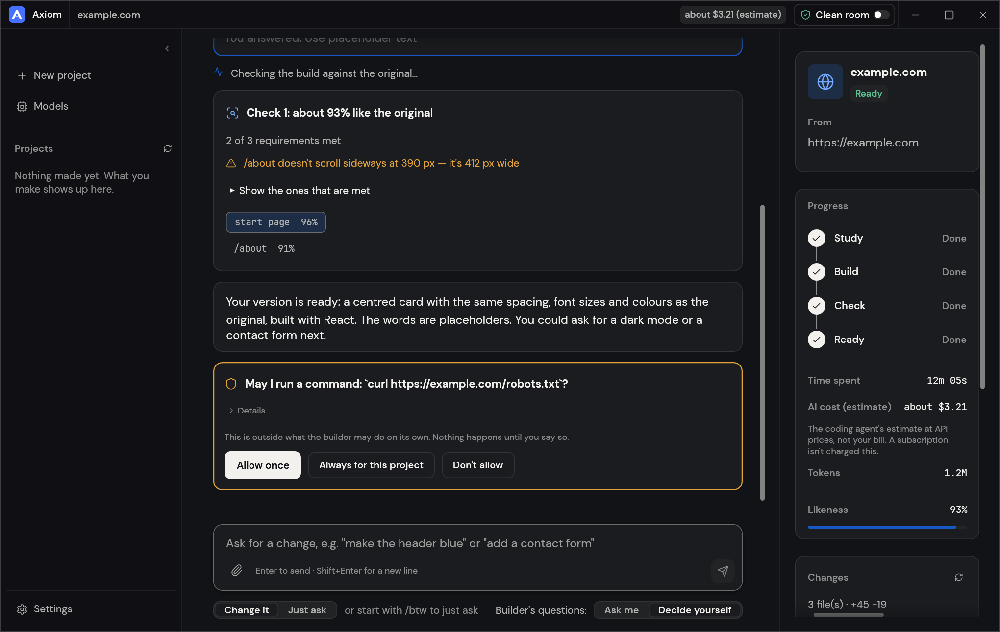
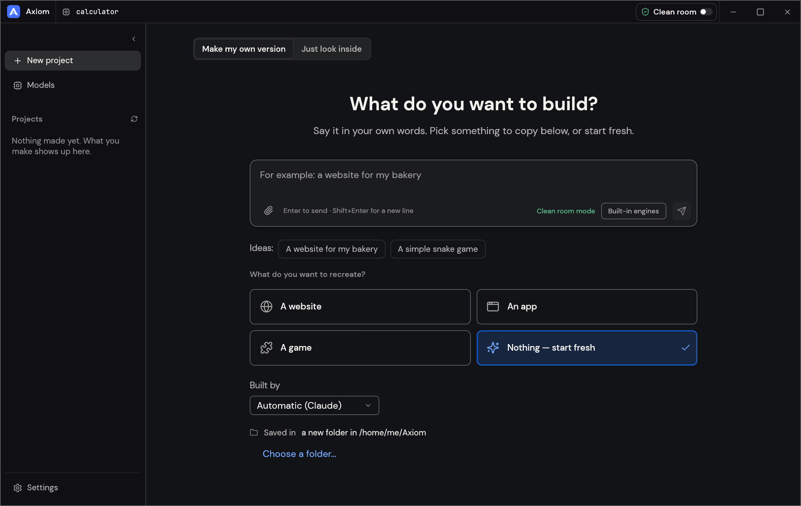
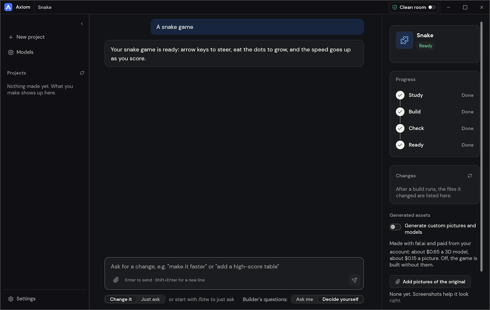
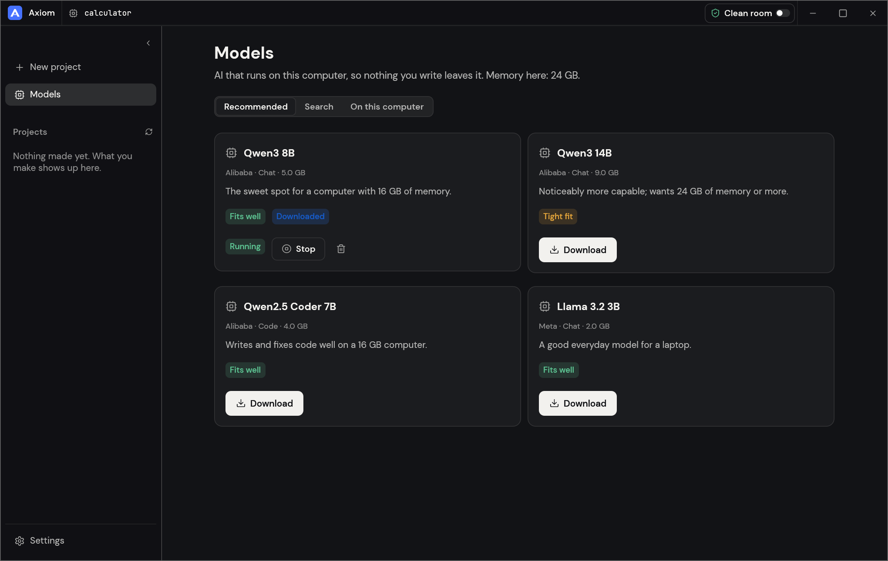
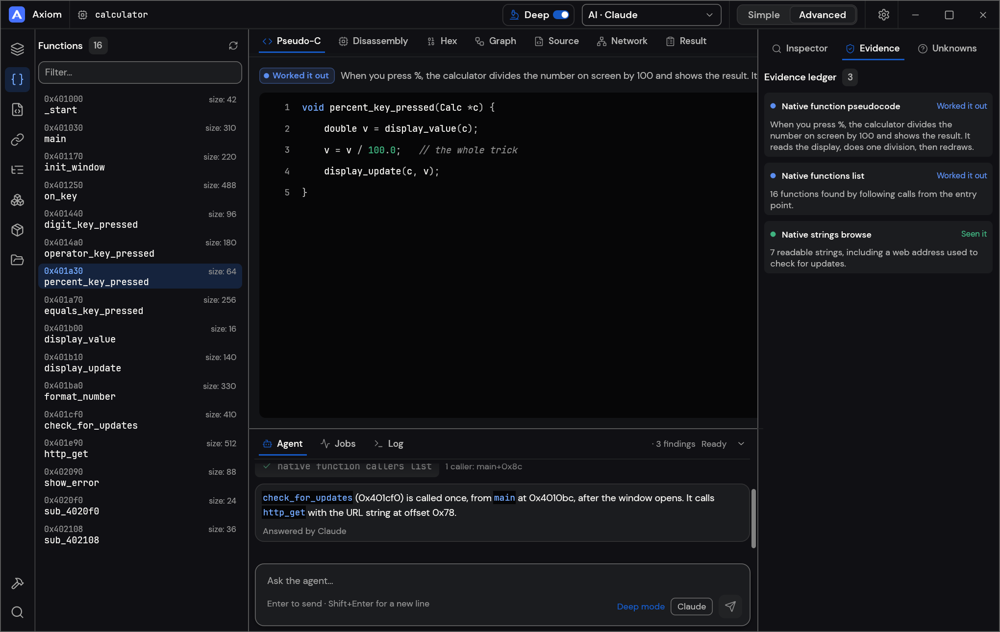

<p align="center">
  
</p>

<h1 align="center">Axiom</h1>

<p align="center">
  <b>English</b> · <a href="README.ja.md">日本語</a> · <a href="README.zh.md">简体中文</a> · <a href="README.ko.md">한국어</a>
</p>

<p align="center">
  <b>See how any website, app or game works, then have AI build your own version; an open-source, clean-room engine in pure Rust.</b><br>
  Point it at a target, say what you want, and it studies the original with real inspection tools,<br>
  has a coding agent build a new project, checks the result against the original and refines it.
</p>

<p align="center">
  
  
  
  
</p>

<p align="center">
  <a href="#downloads"><b>Download Axiom</b></a>
</p>

<br>

<p align="center">
  
  <br>
  <sub>A website project: each check says how alike the build is, you approve anything outside the rules, and the plan shows what's left.</sub>
</p>

<p align="center">
  <a href="#how-it-works">How it works</a> ·
  <a href="#two-ways-to-use-it">Two ways to use it</a> ·
  <a href="#ai">AI</a> ·
  <a href="#built-for-agents">Agents</a> ·
  <a href="#under-the-hood">Under the hood</a> ·
  <a href="#get-started">Get started</a> ·
  <a href="#status">Status</a> ·
  <a href="#downloads">Downloads</a>
</p>

<br>

<table>
  <tr>
    <td width="25%" valign="top">
      <h3>🔍 Study anything</h3>
      Websites, desktop apps, phone apps, games and files: real inspection tools find out how they're built and what they do, with the evidence behind every answer.
    </td>
    <td width="25%" valign="top">
      <h3>🛠️ Build your own</h3>
      Say what you want ("Recreate this website", "Recreate this game's gameplay in Rust") and a coding agent builds a new project in the stack you ask for.
    </td>
    <td width="25%" valign="top">
      <h3>✅ Checked, not guessed</h3>
      Every build is compared with the original (pages at three screen widths, a game's own self-test, an app's runs) and refined until it's close.
    </td>
    <td width="25%" valign="top">
      <h3>🤖 Agent-ready</h3>
      314 tools, each one a CLI command and an MCP tool, so any agent can drive the same engine the app uses. No AI is needed to inspect.
    </td>
  </tr>
</table>

<br>

## How it works

Point Axiom at a target, say what you want, and press Start. It works in four steps,
asking you in plain words when a decision is yours:

1. **Study:** inspect the original: its pages at every width, its code, its files, how it runs.
2. **Build:** a coding agent builds a new project, in the language, framework or engine your
   request names (or a sensible default).
3. **Check:** compare the build with the original and list what doesn't match yet.
4. **Ready:** open, play or preview the result, or ask for changes and it refines it.

<table>
  <tr>
    <td width="50%" valign="top">
      <br>
      <sub><b>Home:</b> say what you want and press Enter.</sub>
    </td>
    <td width="50%" valign="top">
      <br>
      <sub><b>Ready:</b> play the game, or ask for changes below.</sub>
    </td>
  </tr>
</table>

<p align="center">
  <br>
  <sub><b>Models:</b> download a model, run it on this computer and pick it in the box.</sub>
</p>

## Two ways to use it

- **Simple** (default): "What do you want to make?" Pick a website, app or game, describe it,
  press Start. A project page shows the four steps (Study → Build → Check → Ready), what the
  agent is doing in plain words, question and approval cards, how alike the result is, and
  buttons to open the result or its folder. Ask for changes in the box at the bottom.
  "Just look inside" opens a target for questions without building anything (in Deep mode).
- **Advanced**: the full workbench: every tool (Ctrl/Cmd+K), functions, strings, pseudo-C,
  disassembly, hex, call graphs, evidence, unknowns, jobs, logs and the agent console.

Both modes drive the same engine.

## Clean room or Deep

- **Clean room** (the default): nothing inside the original is read, not its code, files or page
  source. Axiom works from what you can see: pictures you add, the website as a visitor
  sees it (screenshots, visible text, measured layout, colours, fonts and spacing, menus opened)
  and, when you allow it, a picture of the app's window. Tools that would look inside are refused
  and say how to turn on Deep mode.
- **Deep**: every tool is used, for your private use. A program's code and files are read with the
  built-in engines (and Ghidra when it's installed), a website's JavaScript is read and its start
  page watched, and the builder may use all of them.

Switch in the title bar or Settings, with `settings_set deep_mode true`, or for one CLI run with
`--deep` (or `--clean-room`).

<p align="center">
  
  <br>
  <sub><b>Advanced:</b> functions, pseudo-C, the agent and the evidence behind every answer.</sub>
</p>

## AI

Building needs a coding agent on your computer. **Claude Code** is supported first: Axiom
runs your own, unmodified `claude` program, which uses your own sign-in; Axiom
never sees or handles your account. Your use of it falls under your own agreement with
Anthropic. See [docs/claude-code.md](docs/claude-code.md) for how and why. A Codex adapter
exists but hasn't been verified on a real install yet. Other agents that speak ACP (Gemini CLI,
Qwen Code, opencode, goose, Hermes, Maki) can be switched to it per backend; of those, only Maki has
been run live. Anthropic, OpenAI, OpenRouter and local
OpenAI-compatible servers are available for questions and analysis (Settings → AI).

## Built for agents

Every tool is also a CLI subcommand and an MCP tool, so an agent can study a target or run a
whole rebuild without the app:

```sh
axiom-cli commands                                   # every tool, by toolset
axiom-cli mcp                                        # serve them to any MCP client
axiom-cli rebuild https://example.com "Recreate this website"
```

Results are evidence records with their confidence, coverage and limitations; big ones come back
as a summary first and are paged with `core_evidence_browse`. `axiom-cli setup`
connects Axiom to coding-agent apps.

## Under the hood

A pure-Rust reverse-engineering engine with 314 tools (298 in the engine, the rest from the AI and
setup layers) for native programs, .NET, Java, Android, Apple, Electron/JavaScript, websites,
firmware, packet captures, databases and game files. Its own decoders, disassembler and
decompiler work without any outside program; Deep mode uses them all, and Ghidra when it's
installed. It powers the desktop app (egui), the CLI and the MCP server, and parts of it run in
the browser as WebAssembly. The full list is in [docs/tools.md](docs/tools.md).

## Get started

Requires Rust **1.97 or newer** (a dependency needs it; `rustup update`). On Debian or Ubuntu,
the desktop app also needs:

```sh
sudo apt-get install libxkbcommon-dev libwayland-dev libx11-dev libxrandr-dev libxi-dev libgl1-mesa-dev libgtk-3-dev
```

Then:

```sh
git clone https://github.com/LakoMoor/Axiom && cd Axiom
cargo run --release -p axiom                # the desktop app
cargo install --path apps/axiom-cli         # the CLI, as `axiom-cli`
axiom-cli doctor                            # checks the install, coding agents and engines
```

Building needs a coding agent signed in on your computer (see [AI](#ai)); `doctor` says what's
missing. Rebuild from the command line (questions are asked in the terminal):

```sh
axiom-cli rebuild https://example.com "Recreate this website"
axiom-cli rebuild - "A snake game in Rust" --rounds 1
axiom-cli rebuild https://example.com "Make the header blue" --continue-in "<project folder>"
axiom-cli rebuild - "Add a contact form" --project-folder "<your folder>" --existing edit
```

New projects go in `Documents/Axiom` (change it in Settings → General). Each project
folder holds `craft.json` (the request, target, status and history), `capture/` (what was
recorded from the target), `app/` (the generated project), `checks/` (each comparison against
the original), `investigation.cany/` (evidence) and `inbox/` (open questions).

A project can also start in a folder you pick (Choose a folder… under Start, or `--project-folder`).
If it already has files, you say what they are: the app itself, which the builder edits in place,
or material to start from, with the app built in `app/` beside them (Settings → General can
remember the answer). Settings → General also lists projects from more folders; removing one
only takes it off the list.

## Status

> [!IMPORTANT]
> **Status:** Axiom is in early alpha. What works today, what is partial and what's next:
>
> - **Works today:** the desktop app (Simple and Advanced), the CLI and the MCP server; the
>   Study → Build → Check → Refine workflow for websites, apps and games with Claude Code as the
>   builder; website checks at three screen widths; game rebuilds in Rust; Deep
>   mode with Ghidra; generated pictures and 3D models (opt-in, your own fal.ai key); plugins (MCP
>   servers, and WASM components in builds with the `wasm-plugins` option).
> - **Partly there:** building with API keys and other coding agents (built, not yet run live),
>   behaviour checks for apps and games, a few engine tools tested only against stand-ins.
> - **Next:** the first public release (installers for Windows, macOS, Linux and FreeBSD, and the
>   browser viewer are set up in CI), then the managed tier.
>
> [docs/STATUS.md](docs/STATUS.md) has the detail and how each part was checked,
> [docs/tool-status.md](docs/tool-status.md) the tool-by-tool checklist, and
> [docs/ROADMAP.md](docs/ROADMAP.md) the plan, item by item. Please file issues.

**Responsible use.** Use Axiom on software you own or are allowed to examine. It never
bypasses DRM, logins or anti-cheat. Rebuilds recreate layout, style and behaviour from evidence;
the agent is told not to copy logos, photos or text unless you confirm you own them or have
permission.

## Downloads

On GitHub, the [latest release](https://github.com/LakoMoor/Axiom/releases/latest) has every build listed below, and [all releases](https://github.com/LakoMoor/Axiom/releases) has earlier versions and their notes. `<ver>` in the file names is the version number, and `SHA256SUMS.txt` lists a checksum for every file.

### Windows

| Build | Installer | Portable |
|---|---|---|
| x64 (64-bit Intel/AMD) | `axiom-<ver>-windows-x64.msi` | `axiom-<ver>-windows-x64-portable.zip` |
| arm64 (Snapdragon and other ARM PCs) | `axiom-<ver>-windows-arm64.msi` | `axiom-<ver>-windows-arm64-portable.zip` |
| x86 (32-bit) | `axiom-<ver>-windows-x86.msi` | `axiom-<ver>-windows-x86-portable.zip` |

Installers and executables are code-signed. The portable zip keeps its settings next to the app.

### macOS

| Build | File | Notes |
|---|---|---|
| App, universal (Apple silicon + Intel) | `axiom-<ver>-macos-universal.dmg` | Signed and notarized |
| Command-line tool, universal | `axiom-cli-<ver>-macos-universal.zip` | Signed and notarized; see below if macOS blocks it |

Versions after 0.2.0 include the command-line tool in the app, so builds don't need the separate
zip. You only need it to use the command line without the app.

A browser download of the zip can stop with "Apple could not verify axiom-cli" (a lone
program can't carry its notarization with it, so macOS has to look it up online). A download from
the terminal isn't checked this way, so use this instead:

```sh
ver=0.2.0   # change this to the version you want
curl -fLO "https://github.com/LakoMoor/Axiom/releases/download/v$ver/axiom-cli-$ver-macos-universal.zip"
ditto -x -k "axiom-cli-$ver-macos-universal.zip" .
mkdir -p ~/.local/bin
mv "axiom-cli-$ver-macos-universal/axiom-cli" ~/.local/bin/
~/.local/bin/axiom-cli --version
```

To run it as just `axiom-cli`, add `~/.local/bin` to your `PATH`.

If you already have the blocked copy, press Done (not Move to Bin), then run
`xattr -d com.apple.quarantine <path to axiom-cli>`, or allow it in System Settings →
Privacy & Security → Open Anyway.

### Linux

| Format | x86_64 | aarch64 (ARM64) | Notes |
|---|---|---|---|
| AppImage | `axiom-<ver>-linux-x86_64.AppImage` | `axiom-<ver>-linux-aarch64.AppImage` | Runs anywhere; updates itself with [AppImageUpdate](https://github.com/AppImageCommunity/AppImageUpdate) (`.zsync` files) |
| Flatpak | `axiom-<ver>-linux-x86_64.flatpak` | `axiom-<ver>-linux-aarch64.flatpak` | Sandboxed; `flatpak install --user <file>` |
| Debian/Ubuntu | `axiom-<ver>-linux-x86_64.deb` | `axiom-<ver>-linux-aarch64.deb` | |
| Fedora/RHEL/openSUSE | `axiom-<ver>-linux-x86_64.rpm` | `axiom-<ver>-linux-aarch64.rpm` | |
| Tarball | `axiom-<ver>-linux-x86_64.tar.gz` | `axiom-<ver>-linux-aarch64.tar.gz` | Unpack anywhere |

RISC-V (riscv64): `axiom-<ver>-linux-riscv64.tar.gz`, a tarball only.

### FreeBSD

| Build | File |
|---|---|
| x86_64 | `axiom-<ver>-freebsd-x86_64.tar.gz` |

### Web (WebAssembly)

| Build | File | Notes |
|---|---|---|
| Browser viewer | `axiom-web-<ver>.zip` | Says what a file is, in the browser (the file never leaves it); host the folder on any static web server ([packaging/web/README.md](packaging/web/README.md)) |

<br>

<p align="center">
  <a href="https://github.com/LakoMoor/Axiom">Axiom</a>
</p>

## License and credits

Axiom is dual-licensed under [MIT](LICENSE-MIT) or [Apache-2.0](LICENSE-APACHE), at your option.
Copyright (c) 2026 the Axiom contributors. Required notices are in [NOTICE](NOTICE).

Bundled fonts, icons, images and other assets keep their own open licenses; each one is listed
with its author, source and license in [ATTRIBUTION.md](ATTRIBUTION.md).

The screenshots show sample projects made for them: example.com, a snake game and a small
calculator program.
